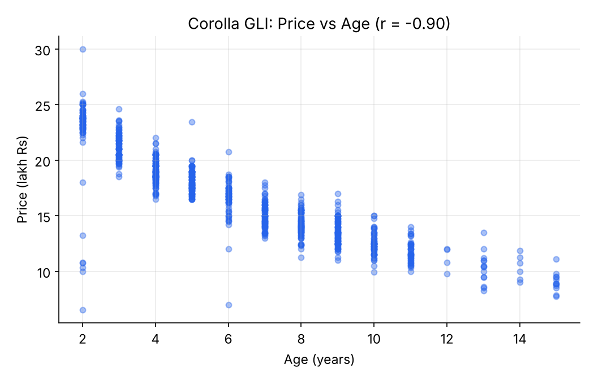
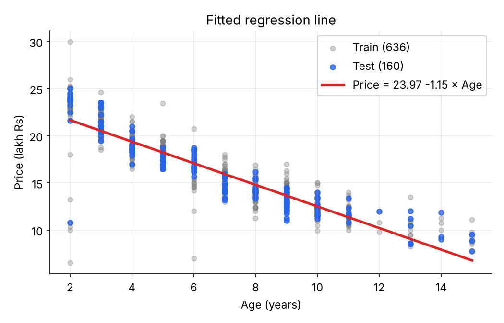
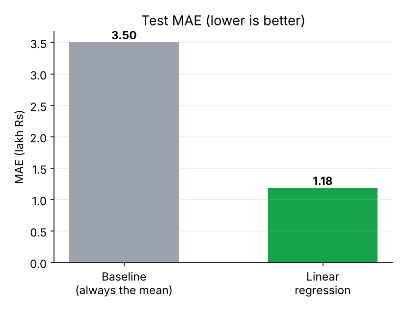
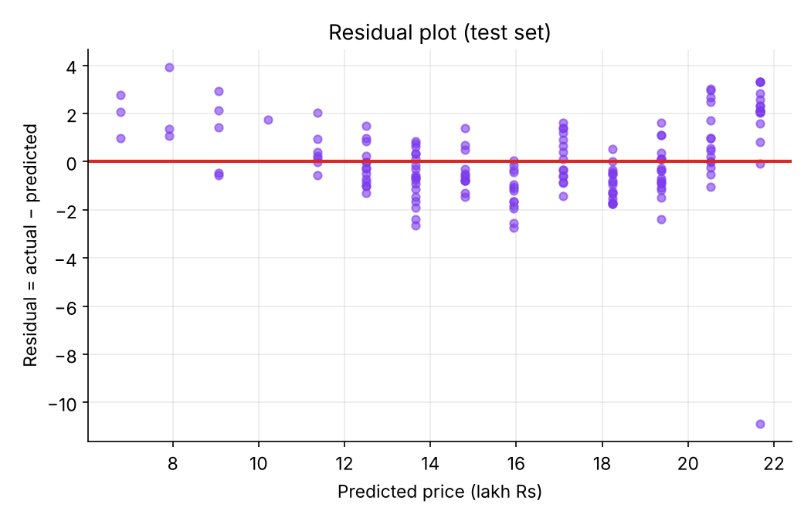
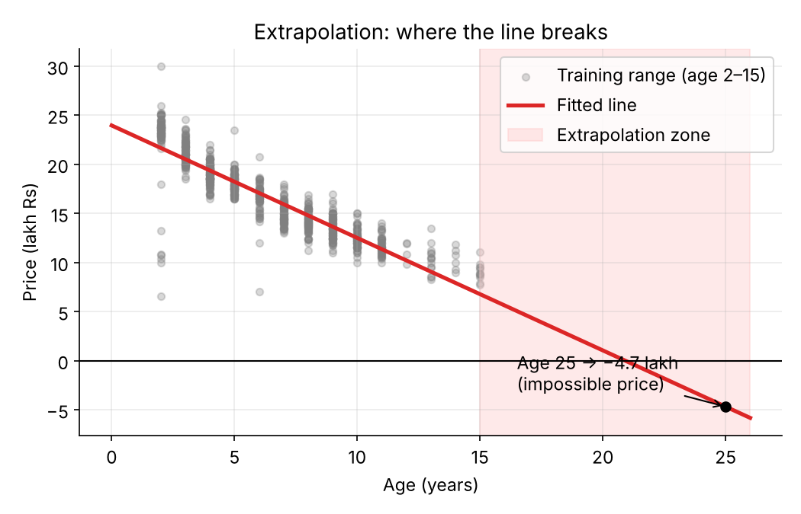

<div align="center">

# 🚗 Predicting Used Car Prices with Simple Linear Regression


*How much should a used Corolla GLI cost if all you know is its age?*

</div>

## 📌 Overview

This lab builds a complete **price predictor** for one car, the **Toyota Corolla GLI**, using real OLX Pakistan ads (Open Data Pakistan, 2021). The workflow covers preparing the data, splitting it, training a simple linear regression with **least squares**, testing it on unseen ads and using the model.

| **Data** | `pakistan_used_cars_clean.csv` (cleaned in Lab 03) |
| **Sample** | 796 Corolla GLI cash ads, 2005–2018, 5–40 lakh |

---

## 🧠 The Model

A straight line learned from 636 training ads:

> ### Price = 23.97 − 1.15 × Age

- **Slope (−1.15):** each extra year of age lowers the price by about **1.15 lakh Rs** (≈ Rs 115,000).
- **Intercept (23.97):** a brand-new (age 0) Corolla GLI is predicted at about **24 lakh Rs**.

---

## 📈 Results

### 1. Is a straight line sensible?
Age and price have a strong negative correlation (**r ≈ −0.90**): older cars are cheaper, and the dots fall roughly along a line.

<div align="center">

</div>

### 2. The fitted line
Grey dots are training ads, blue dots are the unseen test ads. The red line is the least-squares fit.

<div align="center">

</div>

### 3. How good is it?

| Metric | Value | Meaning |
|---|---|---|
| **MAE** | 1.18 lakh | Predictions are off by about **Rs 118,000** on average |
| **RMSE** | 1.64 lakh | Like MAE, but punishes big misses more |
| **R² (test)** | 0.845 | Age explains about **85%** of the variation in price |
| **R² (train)** | 0.790 | Close to test R², so **no overfitting** |

> ⚠️ R² = 0.845 means *"age explains 84.5% of the variation in price"*, **not** *"the model is 84.5% accurate"*.

### 4. Does it beat guessing?
The baseline always predicts the training mean price. The model cuts the average error to about **a third** of the baseline's.

<div align="center">

</div>

### 5. Residuals
Residual = actual − predicted. The largest errors are mostly odd ads (missing KMs, unknown city), so they are **data problems, not model failures**.

<div align="center">

</div>

### 6. Where the model breaks: extrapolation
The model only saw cars aged **2–15 years**. For a 25-year-old car it predicts **−4.7 lakh Rs**, an impossible price. A line keeps falling forever, but real prices level off for very old cars.

<div align="center">

</div>

---

## 🔬 Method

```
Load data → filter Corolla GLI → explore (correlation, scatter)
→ split 80/20 (random_state=42) → least squares with NumPy
→ same with scikit-learn → evaluate on test set → plots & errors
→ predict new cars → reflect
```

| Step | Detail |
|---|---|
| **Split** | 636 train / 160 test ads |
| **Least squares** | b₁ = Σ(x − x̄)(y − ȳ) / Σ(x − x̄)², b₀ = ȳ − b₁x̄ |
| **Check** | NumPy and scikit-learn give identical coefficients |
| **Baseline** | Predict the training mean for every test ad |

---

## ⚠️ Limitations

- Uses **age only**. Mileage, condition, city and seller also affect price.
- Built for **one model** (Corolla GLI, cash ads only).
- Unreliable **outside ages 2–15** (extrapolation).

---

## 🗂️ Repository Structure

```
ML-Lab-<RollNo>/
└── Lab05/
    ├── Lab05.ipynb                    # Notebook (tasks 1–8)
    ├── pakistan_used_cars_clean.csv   # Cleaned dataset
    ├── images/                        # Plots used in this README
    └── README.md
```

<div align="center">

Made with ❤️ using Python, Pandas & scikit-learn

</div>
